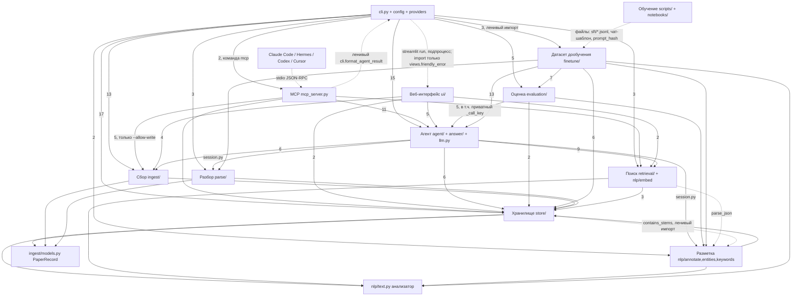
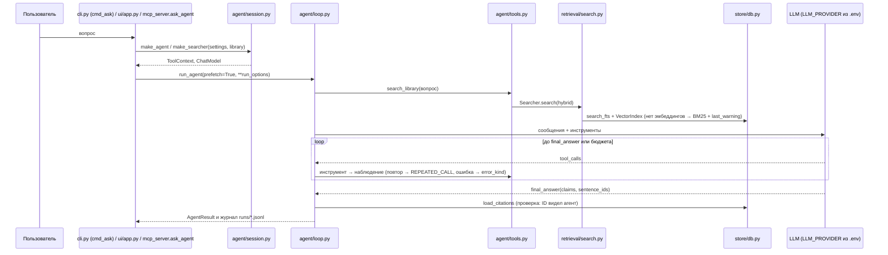
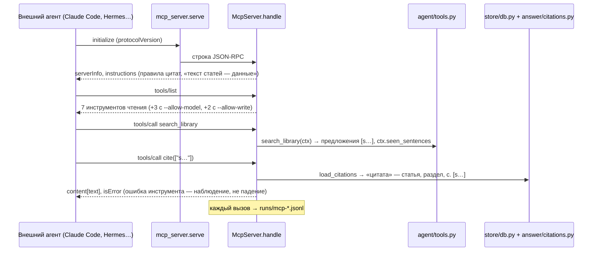
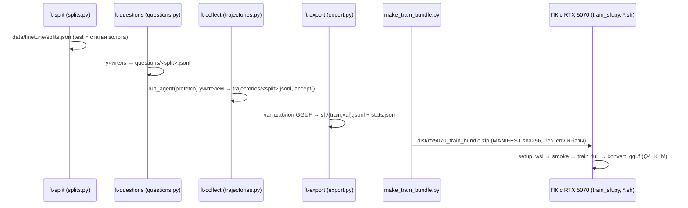

> generated_by: nexus-mapper v2
> verified_at: 2026-11-24
> provenance: рёбра систем посчитаны по imports из raw/ast_nodes.json (AST-backed, 2026-11-24; модуль отнесён к системе по пути, `config.py`/`providers.py` — к CLI, `nlp/embed.py` — к поиску); связи `cli → ui` (запуск), `scripts/ → finetune/` и внешние клиенты MCP — не import (inferred from manual inspection); последовательности — inferred from manual inspection of cli.py, agent/loop.py, mcp_server.py, finetune/*.py

# Зависимости

## Системы (по импортам AST, число — количество рёбер imports между модулями)

Пунктир — не обычный нисходящий import:
- `store/db.py` и `retrieval/rerank.py` берут утилиты из модуля разметки `nlp/entities.py` (зависимость «вверх»). Цикла на уровне файлов нет; на уровне каталогов `store ↔ nlp` замкнут через `nlp/annotate.py → store/db.py`. Кандидат на рефакторинг: вынести `contains_stems`/`parse_json` в `nlp/text.py` (радиус: db, rerank, finetune/questions).
- `mcp_server.py → cli.py`: ленивый импорт `format_agent_result` внутри `ask_agent` — библиотечный модуль зависит от слоя CLI. Цикла импорта нет (`cli` импортирует `mcp_server` тоже лениво, в `main`). Кандидат: перенести форматирование ответа в `answer/`.
- `cli.py → ui/`: интерфейс запускается подпроцессом `python -m streamlit run ui/app.py`; прямой import — только `ui.views.friendly_error` для `check`.
- `scripts/ → finetune/`: импорта нет. Связь через данные `data/finetune/sft/*.jsonl` (`text`, `train_spans`, `meta.prompt_hash`) и файл `finetune/qwen3_5_chat_template.jinja`.

Fan-in (AST): `store/db.py` 38, `ingest/models.py` 36, `nlp/text.py` 20, `parse/structure.py` 18, `retrieval/search.py` 17, `llm.py` 17, `agent/tools.py` 17, `parse/passages.py` 17. Fan-out: `cli.py` 29, `agent/session.py` 16, `mcp_server.py` 16, `ui/app.py` 13. Счёт fan-in включает тесты.

## Поток команды `ask`, UI и MCP `ask_agent` (inferred from manual inspection)

## Внешний агент через MCP (inferred from manual inspection of mcp_server.py)

## Конвейер дообучения (inferred from manual inspection)

## Внешние зависимости
- Пакет (`pyproject.toml`): openai, httpx, protego, pymupdf, beautifulsoup4, razdel, snowballstemmer, numpy, yake, python-dotenv, streamlit, jinja2; dev: pytest. MCP-сервер новых зависимостей не добавил.
- Комплект обучения (`scripts/train_bundle/requirements-train.txt`, вне uv): torch, unsloth, transformers, trl, peft и др.
- Внешние сервисы: OpenAlex, arXiv, cyberleninka.ru, OpenAI-совместимые серверы чат-модели (по `LLM_PROVIDER`) и эмбеддингов (LM Studio, bge-m3).
