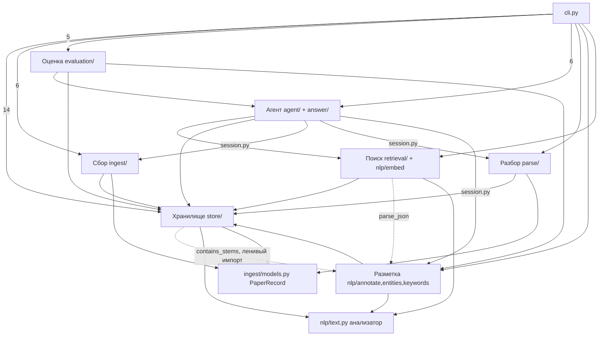
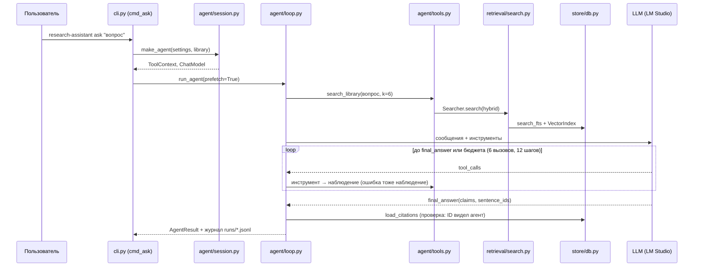

> generated_by: nexus-mapper v2
> verified_at: 2026-10-22
> provenance: рёбра систем посчитаны по imports из raw/ast_nodes.json (AST-backed); последовательность вызовов в ask — inferred from manual inspection of cli.py, agent/session.py, agent/loop.py

# Зависимости

## Системы (по импортам AST, число — количество рёбер imports)

Пунктир — зависимости «вверх»: нижние слои (хранилище, поиск) берут утилиты из модуля разметки `nlp/entities.py`. Цикла на уровне файлов нет (`nlp/entities.py` не импортирует `store`), но на уровне каталогов `store ↔ nlp` замкнуто через `nlp/annotate.py → store/db.py`. Кандидат на рефакторинг: вынести `contains_stems` и `parse_json` в `nlp/text.py` или отдельный `nlp/util.py`.

## Поток команды `ask` (inferred from manual inspection)

## Внешние зависимости (pyproject.toml)
openai, httpx, protego, pymupdf, beautifulsoup4, razdel, snowballstemmer, numpy, yake, python-dotenv. Внешние сервисы: OpenAlex API, arXiv API и arxiv.org/pdf, страницы cyberleninka.ru, OpenAI-совместимый сервер модели и эмбеддингов (по `.env`).
