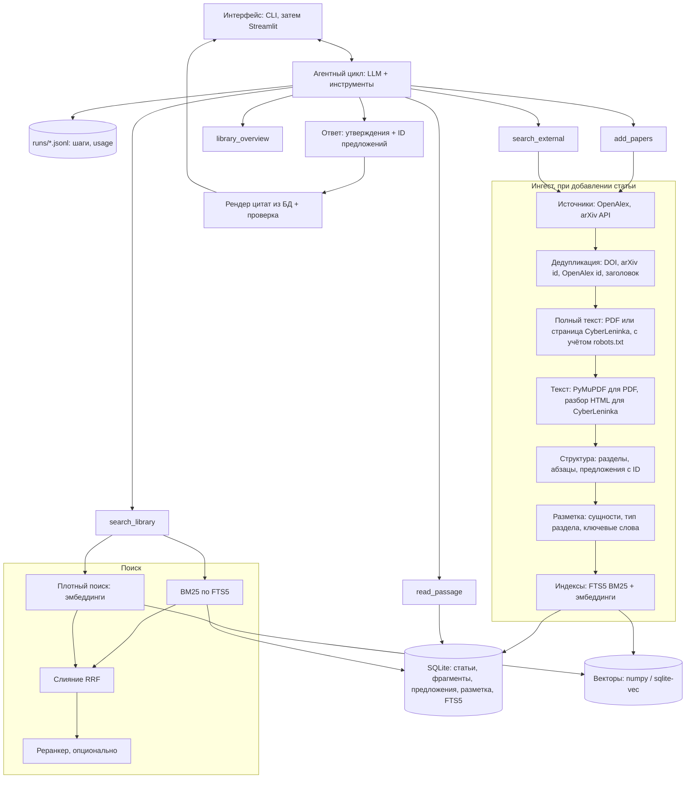

# Ассистент исследователя: план проекта

Проект по курсу «Агентный ИИ: теория и инженерия» (MMCS, осень 2026). Индивидуальный.

## 1. Постановка

Пользователь задаёт тему. Агент:

1. находит и скачивает статьи по теме;
2. хранит их в локальной библиотеке и размечает (сущности, разделы, ключевые слова);
3. отвечает на вопросы по библиотеке, подкрепляя каждое утверждение **точной цитатой** (статья, раздел, страница).

**Что значит «точная цитата».** Текст цитаты совпадает с источником символ в символ (после нормализации пробелов и переносов). Модель не переписывает цитату сама: она ссылается на идентификаторы предложений, а текст подставляет код. Поэтому точность цитат гарантирована механизмом, а не просьбой в промпте. Проверяется только, что цитата действительно подтверждает утверждение.

### Сценарии использования

| # | Пользователь говорит | Агент делает |
|---|---|---|
| 1 | «Собери статьи про speculative decoding за 2023–2026» | Ищет в arXiv/OpenAlex, показывает кандидатов, добавляет выбранные в библиотеку |
| 2 | «Какие датасеты используют для оценки?» | Ищет по библиотеке с фильтром по сущностям, отвечает списком с цитатами |
| 3 | «Что говорят о недостатках метода X?» | Ищет в разделах «ограничения» и «обсуждение», отвечает цитатами |
| 4 | «Сравни статьи A и B по метрикам» | Достаёт результаты обеих статей, сводит в таблицу со ссылками на предложения |
| 5 | «Что есть в библиотеке по теме Y?» | Показывает статьи, теги, ключевые слова |

## 2. Архитектура



### Ключевые решения

1. **Свой агентный цикл без фреймворка**, как в задании 1: лимит шагов, ошибки инструментов возвращаются модели как наблюдения, журнал в JSONL, счётчики токенов из `usage`. Модель вызывается через OpenAI-совместимый API (`OPENAI_BASE_URL`, `OPENAI_API_KEY`, `MODEL`). Это позволяет переключаться между локальным LM Studio и облачным провайдером без изменений кода.
2. **Одно хранилище: SQLite.** Метаданные, структура, разметка и полнотекстовый индекс FTS5 с встроенным BM25 лежат в одном файле. Корпус учебного проекта — сотни статей, до ~100 тыс. фрагментов, поэтому векторный поиск перебором по numpy-матрице укладывается в десятки миллисекунд. Отдельный Qdrant или Chroma не нужен; если понадобится, подключается за интерфейсом `VectorIndex`.
3. **Цитаты по ID предложений.** Поиск возвращает абзацы, в которых каждое предложение помечено коротким ID: `[s1042] ...`. Финальный ответ — структура «утверждение → список ID». Текст цитат, статью, раздел и страницу подставляет код.
4. **Гибридный поиск.** BM25 и плотный поиск сливаются через Reciprocal Rank Fusion, затем опционально идёт кросс-энкодер. Пользователь спрашивает по-русски, а статьи в основном на английском. Поэтому для плотного поиска нужна многоязычная модель эмбеддингов, а для BM25 агент сам формулирует запрос на английском. Это и есть «агентный RAG» из лекций.
5. **Разметка через структурированный вывод LLM** по аннотации и заголовкам разделов, плюс YAKE для ключевых слов. Качество проверяется на вручную размеченном наборе.
6. **Инструменты возвращают сжатый результат**: топ-k с обрезанным текстом и ID, а не весь ответ БД. Подробности агент запрашивает отдельно через `read_passage`.

### Инструменты агента

| Инструмент | Что делает | Что возвращает |
|---|---|---|
| `search_external(query, year_from, limit)` | Ищет статьи во внешних источниках | До 10 кандидатов: id, заголовок, год, авторы, 1–2 предложения аннотации |
| `add_papers(ids, topic)` | Скачивает, разбирает, размечает и индексирует | Сколько добавлено, сколько пропущено и почему |
| `library_overview(topic?)` | Описывает содержимое библиотеки | Число статей, список с тегами, частые сущности |
| `search_library(query, k, filters)` | Гибридный поиск; фильтры по теме, году, типу раздела, сущности | k абзацев с ID предложений, статьёй, разделом, страницей |
| `read_passage(passage_id, window)` | Читает соседние абзацы | Текст с ID предложений |

Финальный ответ модель возвращает по JSON-схеме:

```json
{
  "answer": "краткий ответ своими словами",
  "claims": [
    {"text": "утверждение", "citations": ["s1042", "s1043"]}
  ],
  "not_found": false
}
```

Если подходящих цитат нет, агент обязан вернуть `not_found: true`, а не отвечать «из головы».

### Схема данных

```
topics(id, name, query, created_at)
papers(id, arxiv_id, doi, title, authors, year, venue, abstract, source, url, pdf_path, added_at)
paper_topics(paper_id, topic_id)
sections(id, paper_id, title, kind, order_idx)        -- kind: abstract/intro/method/results/limitations/...
passages(id, paper_id, section_id, page, order_idx, text)
sentences(id, passage_id, order_idx, text, char_start, char_end)
entities(id, paper_id, passage_id, type, text, norm)   -- type: method/dataset/metric/task
keywords(paper_id, keyword, score)
passages_fts                                          -- FTS5 по passages.text
embeddings: data/vectors.npy + data/vectors_ids.npy
```

## 3. Стек

| Задача | Выбор | Запасной вариант |
|---|---|---|
| Окружение | Python 3.12, uv, pytest | — |
| LLM | OpenAI-совместимый API: LM Studio локально или облачный провайдер | — |
| Источники | OpenAlex API (основной, в том числе русские статьи через `language:ru`), arXiv API | Semantic Scholar API |
| Полные тексты | PDF с arXiv и сайтов журналов, HTML-страницы статей CyberLeninka; robots.txt через `protego` | — |
| PDF | PyMuPDF | GROBID (Docker) для сложных PDF |
| Хранилище | SQLite + FTS5 | PostgreSQL |
| Эмбеддинги | `BAAI/bge-m3` или `intfloat/multilingual-e5-base` (многоязычные) | `/v1/embeddings` из LM Studio |
| Реранкер | `BAAI/bge-reranker-v2-m3` | без реранкера |
| Ключевые слова | YAKE | KeyBERT |
| Интерфейс | CLI, затем Streamlit | Telegram-бот |

## 4. Структура репозитория

```
research-assistant/
  AGENTS.md             # инструкция для агента для кода
  PLAN.md               # этот файл
  README.md             # запуск одной командой
  .env.example
  src/research_assistant/
    config.py           # настройки из .env
    llm.py              # клиент модели, учёт usage
    agent/              # цикл, инструменты, промпты, формат ответа
    ingest/             # источники, дедупликация, скачивание полных текстов
    parse/              # PDF и HTML → разделы, фрагменты, предложения со страницами
    nlp/                # разметка, эмбеддинги, ключевые слова
    store/              # SQLite-схема, доступ к данным, векторный индекс
    retrieval/          # BM25, плотный поиск, RRF, реранкер
    answer/             # рендер и проверка цитат
    ui/                 # Streamlit: app.py — страница, views.py — данные для неё
    cli.py
  eval/                 # наборы вопросов и задач, скрипты метрик
  runs/                 # журналы прогонов агента (JSONL)
  data/                 # PDF, БД, векторы (не в git)
  tests/
  docs/                 # отчёт, схемы
```

## 5. Этапы

Даты ориентировочные: десять недель с 6 октября. Минимально рабочая версия (MVP) готова после этапа 5.

| Неделя | Этап | Готово, когда |
|---|---|---|
| 1 (6–12 окт) | Каркас, окружение, проверка провайдера (вызов инструментов + `usage`), выбор 2–3 тестовых тем | `uv sync` и `uv run pytest` проходят, модель вызывает инструмент |
| 2 (13–19 окт) | Сбор: arXiv и OpenAlex, дедупликация, SQLite-схема, команда `ingest` | По теме загружаются 30 статей без дублей |
| 3 (20–26 окт) | PDF → разделы → абзацы → предложения с ID и страницами | На 5 статьях структура проверена глазами, есть тесты |
| 4 (27 окт–2 ноя) | FTS5 BM25, эмбеддинги, RRF; первые 30 золотых вопросов | Посчитаны Recall@k и MRR для трёх вариантов поиска |
| 5 (3–9 ноя) | Агентный цикл, инструменты, JSONL, ответ с цитатами по ID | Агент из CLI отвечает с цитатами, журнал пишется |
| 6 (10–16 ноя) | Разметка: сущности, тип раздела, ключевые слова; золотой набор из 50 аннотаций | Посчитаны P/R/F1, фильтры работают в поиске |
| 7 (17–23 ноя) | Реранкер, межъязыковой поиск, сравнение статей | Эксперименты E1–E3 посчитаны |
| 8 (24–30 ноя) | Streamlit: чат, карточки цитат, библиотека, фильтры | Демо работает в браузере |
| 9 (1–7 дек) | Полная оценка: задачи ×3 прогона, сравнение моделей, разбор ошибок | Таблицы метрик с интервалами |
| 10 (8–14 дек) | Отчёт, презентация, демо-видео, проверка запуска на чистой машине | Всё сдаётся по README одной командой |

Если останется время: экспорт в BibTeX, граф цитирований, еженедельная проверка новых статей по теме, Telegram-бот.

## 6. Оценка

### Наборы данных

- **Тестовый корпус:** 2–3 темы по 20–40 статей, зафиксированные списком ID, чтобы прогоны были воспроизводимы.
- **Вопросы и золотые фрагменты:** 60 вопросов (половина на русском, половина на английском), к каждому — ID предложений, где есть ответ. Черновики вопросов генерирует LLM по случайным предложениям, человек проверяет и правит.
- **Сущности:** 50 аннотаций, размеченных вручную (методы, датасеты, метрики, задачи).
- **Сквозные задачи агента:** 15 задач с проверяемым итогом («добавь статьи по X за 2024 год и назови датасеты, на которых их оценивают»).

### Метрики

| Что | Метрика |
|---|---|
| Поиск | Recall@5, Recall@10, MRR@10, nDCG@10 |
| Цитаты | Доля дословных цитат; доля утверждений, которые цитата подтверждает (LLM-судья, откалиброванный на 50 ручных метках, каппа Коэна) |
| Ответ | Правильность ответа на золотых вопросах; доля верных `not_found` |
| Разметка | Precision, recall, F1 по типам сущностей |
| Агент | pass@1, pass^3, число шагов, токены, стоимость и время на задачу; интервалы Вильсона |

### Эксперименты

| # | Сравнение | Вопрос |
|---|---|---|
| E1 | BM25 / плотный / гибрид RRF / гибрид + реранкер | Что даёт гибрид и окупается ли реранкер по задержке |
| E2 | Цитата текстом от модели / цитата по ID предложения | Сколько цитат модель искажает, если переписывает их сама |
| E3 | Однократный RAG / агентный RAG с переформулировкой запроса | Помогает ли итеративный поиск, особенно на русских вопросах |
| E4 | Локальная модель (LM Studio) / облачная модель | Точность против стоимости и задержки (фронт Парето) |
| E5 | Абзацы / фиксированные окна по 512 токенов | Влияние нарезки на поиск (если будет время) |

Неудачные траектории разбираются по классам из задания 1: не тот инструмент, не те аргументы, ошибка среды, зацикливание, ложное «готово».

## 7. Риски

| Риск | Что делаем |
|---|---|
| PDF разбираются плохо (колонки, формулы, таблицы) | Фильтр мусорных блоков, HTML-версии arXiv, GROBID как запасной вариант |
| Внешние API ограничивают частоту запросов | Кэш ответов на диске, паузы между запросами, зафиксированный корпус для оценки. arXiv API из нашей сети часто отвечает 429 и таймаутами, поэтому основной источник — OpenAlex: он индексирует arXiv, а PDF качаются с arxiv.org напрямую |
| Правила сайтов (robots.txt) | Перед каждым скачиванием проверяется robots.txt с учётом шаблонов и Crawl-delay. CyberLeninka запрещает роботам свой поиск, API и PDF, поэтому русские статьи ищем через OpenAlex, а текст берём с разрешённых страниц статей |
| Внешний поиск возвращает много нерелевантного (особенно по-русски: OpenAlex ищет и по полным текстам, а поиск только по заголовку и аннотации находит единицы) | Агент показывает кандидатов и добавляет выбранные; на этапе 4 — отсев по близости эмбеддингов к теме |
| Маленькая локальная модель плохо вызывает инструменты | Облачная модель как основная, локальная — для эксперимента E4 |
| Русский вопрос по английским статьям | Многоязычные эмбеддинги + переформулировка запроса агентом. Подтверждено замером: BM25 и англоязычные эмбеддинги дают Recall@10 0.20 и 0.00 на вопросах ru→en |
| Золотые вопросы написаны по тексту фрагментов и лексически близки к ним | Добавить перефразированные вопросы и вопросы от второго человека; в отчёте отделять метрики по типам вопросов |
| Идентификаторы предложений меняются при переразборе (новая версия парсера) | Золотые наборы для оценки ссылаются на статью и текст предложения, а не на его id; id используются только внутри одного прогона |
| Мало времени на ручную разметку | Черновики от LLM, человек только проверяет; наборы небольшие, но честные |
| Агент отвечает без опоры на источники | `not_found` в схеме ответа, утверждения без цитат отбрасываются при рендере |

## 8. Отчёт и защита

Отчёт лежит в `docs/` и содержит:

1. постановку и архитектуру;
2. описание данных и разметки;
3. таблицы метрик с интервалами и выводы по экспериментам E1–E4;
4. разбор трёх-пяти неудачных траекторий;
5. ограничения и что дальше;
6. раздел «что делал агент для кода, что проверял я» (требование курса).

## 9. Решения и открытые вопросы

Решено:

- Проект индивидуальный.
- Модели: и локальная (LM Studio, RTX 3060 6 ГБ), и облачная; сравнение — эксперимент E4.
- Русские статьи нужны: ищем через OpenAlex (`--language ru`), полный текст — PDF журнала или страница CyberLeninka.

Открыто:

- Срок сдачи и формат защиты. От них зависит график.
- Какой облачный провайдер.

## 10. Журнал этапов

| Этап | Статус | Что сделано |
|---|---|---|
| 1 | готов | Каркас на uv, `AGENTS.md`, настройки из `.env`, команда `check`: обе локальные модели (qwen3.5-0.8b, gemma-4-e4b) вызывают инструменты и отдают `usage` |
| 2 | готов | Источники OpenAlex и arXiv, слияние дублей по DOI / arXiv id / OpenAlex id / заголовку, SQLite-библиотека, скачивание полных текстов с проверкой robots.txt, команды `ingest` и `library`. Проверка на реальных данных: «speculative decoding» — 40 результатов → 33 статьи без дублей, 31 PDF; «машинное обучение в медицине» (ru) — 30 → 29 статей, 22 полных текста (20 PDF, 2 страницы CyberLeninka) |
| 3 | готов | Пакет `parse/`: PDF (PyMuPDF) и страницы CyberLeninka приводятся к строкам с признаками оформления; по ним собираются разделы (нумерация, капс, жирный шрифт, известные названия, тип раздела), абзацы (склейка между колонками и страницами, снятие переносов по словарю документа, подписи к рисункам), предложения (razdel + правила для научных сокращений и ссылок в скобках) со страницами. Отсеиваются колонтитулы, номера страниц, сноски, формулы, штамп arXiv, шапка статьи, список литературы; приложения после литературы сохраняются. Статья внутри сборника или целого выпуска журнала находится по заголовку. Без полного текста в поиск идёт аннотация из метаданных. Итог по библиотеке: 53 полных текста разобраны (аннотация найдена в 48), 9 статей — по метаданным; 940 разделов, 3844 фрагмента (медиана 49 слов), 11 729 предложений; каждое предложение посимвольно совпадает со срезом своего фрагмента. Проверено глазами на статьях arXiv, ACL, ICLR, русских сборниках, CyberLeninka и выпусках журналов |
| 4 | готов | BM25 через SQLite FTS5 по основам слов (Snowball для английского и русского), плотный поиск через `/v1/embeddings` любого OpenAI-совместимого сервиса с перебором по numpy-матрице, слияние RRF, фильтры по теме, году, типу раздела и языку; команды `index`, `search`, `eval-retrieval`. Черновой золотой набор из 30 вопросов (10 en→en, 10 ru→en, 10 ru→ru), золото задано цитатой, а не id. Эксперимент E1 (docs/experiments.md): англоязычные эмбеддинги и скрытые состояния чат-модели не умеют межъязыковой поиск (ru→en = 0); многоязычная bge-m3 даёт ru→en 0.80, а гибрид BM25 + bge-m3 — Recall@10 0.93 и MRR@10 0.69 по всем вопросам. bge-m3 принята по умолчанию. Предварительный E3: перевод запроса даже моделью на 0.8B поднимает BM25 на ru→en с 0.20 до 0.80, но ломает ru→ru — агенту нужно выбирать язык поиска. Осталось на потом: проверка вопросов человеком, перефразированные вопросы, реранкер (этап 7) |
| 5 | готов | Свой агентный цикл без фреймворка: лимит шагов, ошибки инструментов как наблюдения, журнал JSONL с usage, бюджет исследования (после 6 поисков/чтений и на последнем шаге — только `final_answer`). Инструменты: `search_library`, `read_passage`, `library_overview`, `search_external`, `add_papers`, `final_answer`. Ответ — утверждения с ID предложений; принимается, только если все ID агент видел в выдаче, текст цитат подставляет код. Команды `ask` и `chat` (память на 3 прошлых вопроса). Модель — Qwen3.5-4B Q4_K_M локально (LM Studio, контекст 16K, без размышлений): типичный ответ — 5–7 шагов, 15–30 тыс. токенов, 20–30 с. Три разбора ошибок — в docs/experiments.md: зацикливание, не те аргументы (фильтр разделов, путаница ID), утверждение не подтверждается цитатой |
| 6 | готов | Разметка: сущности (метод, датасет, метрика, задача) извлекает Qwen3.5-4B со структурированным выводом по аннотации, заключению и началу экспериментов; сущность остаётся, только если встречается в тексте (по основам слов). Сущности привязаны ко всем фрагментам статьи, ключевые слова — YAKE. Фильтр `entity` в поиске, инструмент агента `list_entities`, команды `annotate`, `entities`, `eval-entities`. Золотой набор из 30 аннотаций (171 сущность) и правила разметки; F1 = 0.70 (en 0.76, ru 0.54), проверка по тексту +0.03 F1 без потери полноты; Qwen3.5-0.8B — F1 0.45. Тип раздела остаётся эвристическим (этап 3) |
| 7 | готов | Перевод запроса в поиске (`--translate`, ru→en Recall@10 0.80 → 0.90) и listwise-реранкер на чат-модели (`--rerank`; на Qwen3.5-4B вредит, выключен); инструмент `compare_papers`; оценка агента `eval-agent` с pass@1, pass^k и интервалом Вильсона, строгим (золотой фрагмент) и мягким (золотая статья) критериями, пересчёт по журналам. E2: цитаты по ID — 100% дословно и pass@1 0.80; цитаты текстом — 96% дословно и 0.63. E3: агент 0.80, однократный поиск 0.90 (в 10 раз дешевле), поиск по вопросу заранее + агент — 0.97, включён по умолчанию. Найдены и описаны две ошибки измерения: слишком строгий критерий успеха агента и метки ID внутри цитат |
| 8 | готов | Веб-интерфейс на Streamlit, команда `ui`: разделы «Вопрос агенту» (диалог с prefetch, утверждения с цитатами — статья, раздел, страница, ссылка на страницу PDF, раскрываемый контекст фрагмента с выделенной цитатой), «Поиск» (фильтры по теме, режиму, разделам, языку, сущности, перевод запроса) и «Библиотека» (темы, статьи со статусами, сущности темы, карточка статьи с разделами). Логика вынесена в `ui/views.py` и покрыта тестами, страница проверяется через `streamlit.testing.AppTest` на временной базе. Вместо вкладок — разделы в боковой панели: Streamlit рисует все вкладки сразу, и таблицы в скрытых получали нулевую ширину. После отзыва («ничего не понятно, история не сохраняется») переделан: приветствие с примерами вопросов, ход работы агента в реальном времени (`run_agent(on_event=...)`), блок «Откуда это известно» с кнопкой «Открыть PDF на с. N», понятные тексты ошибок; история чатов в `data/chats/*.json` с продолжением диалога; раздел «Статьи» — поиск по автору, словам из названия и аннотации (все слова, по основам) и по смыслу аннотаций (`retrieval/papers.py`); у агента инструмент `find_papers` и фильтр `paper_ids` в `search_library`. Поиск новых статей по автору (OpenAlex: профили авторов со сверкой имени; arXiv: `au:`), вкладка «Новые статьи в интернете» с добавлением по галочкам; `add_papers` доступен агенту только при явной просьбе добавить (`wants_to_add`): при проверке Qwen3.5-4B на «найди статьи Хинтона» сама добавила 10 статей |
